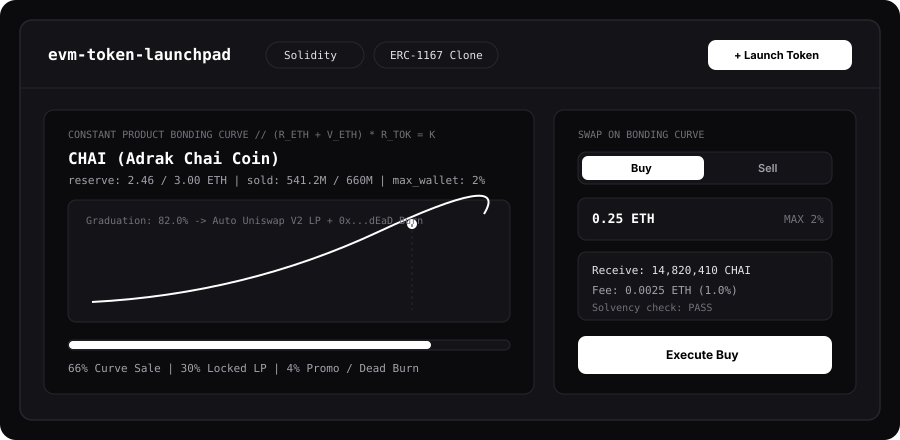

# evm-token-launchpad


Launch a fair ERC20 token for pennies using minimal proxy clones, trade it on an `x * y = k` bonding curve, and auto graduate liquidity straight to Uniswap V2.

Works on pure divine Solidity math and 3am adrak chai. When i wrote `_ceilDiv` for dust attack protection, only me and bhagwan knew how the rounding worked. Now only bhagwan knows, and the solvency check never breaks.



## what is this

`evm-token-launchpad` is a clean Solidity `0.8.24` bonding curve token factory plus a minimal browser trading terminal.

* **85% cheaper token deploys**: `BondingCurveFactory` clones `CurveToken` via OpenZeppelin `ERC1167` minimal proxies instead of deploying fat bytecode every time.
* **Anti whale curve phase**: Every wallet holds at most 2% of supply while on the curve. When the pool graduates to Uniswap V2, limits turn off automatically.
* **Auto Uniswap V2 graduation**: Once real ETH hits target, `migratePool` wraps ETH into WETH, seeds the Uniswap V2 pair, and burns LP tokens to `0x000000000000000000000000000000000000dEaD`.
* **Built in 7 day safety valve**: If a pool hits target and nobody migrates it for 7 days, holders can burn tokens for their exact ETH share. It is not a bug bhai, it is a surprise feature that saves stuck ETH.

## copy and run in 60 sec

```bash
git clone https://github.com/LevCodeLab/evm-token-launchpad.git
cd evm-token-launchpad
cp .env.example .env
npm install

# compile solidity 0.8.24 contracts and run full test suite
npm run compile
npm test

# test local mock deployment on in memory hardhat chain
npm run deploy:local
```

Want to open the minimal monochrome web UI:

```bash
npm run ui
```

Open `http://localhost:5173` in your browser. It runs an instant curve simulator out of the box, or paste your deployed `BondingCurveFactory` address at the top to trade on chain with MetaMask or Rabby.

## where to edit code

| File | What to change here |
| :--- | :--- |
| `contracts/BondingCurveFactory.sol` | Virtual reserves (`3 ETH`, `1.32B` tokens), fees, and Uniswap V2 LP migration |
| `contracts/CurveToken.sol` | `ERC1167` cloneable `ERC20` with 2% max wallet guard |
| `contracts/Mocks.sol` | Local `MockWETH`, `MockUniswapV2Factory`, and Chainlink oracle mock |
| `scripts/deploy.js` | Deployment script with `0x0000...` safety checks and local mock setup |
| `hardhat.config.js` | Solidity `0.8.24` Cancun compiler settings and EVM network configs |
| `frontend-v2/index.html` | Minimal dark obsidian launchpad and swap UI |
| `frontend-v2/app.js` | Browser `ethers` v6 contract calls and local `x * y = k` quote math |
| `test/BondingCurveFactory.test.js` | Hardhat tests for clones, fee splits, dust trades, and LP burn |

## license

MIT License. Clone it, break it, ship it. See [LICENSE](./LICENSE).
